<!-- _header: "" -->
<!-- _footer: "" -->
<!-- _paginate: false -->

# Data Science and Engineering: We Were on a Break!

<strong>Romain Clement · Datalpia</strong>
Compute! Paris 2026 · November 26th 2026

---

## ✨️ Once upon a time...

* 
* 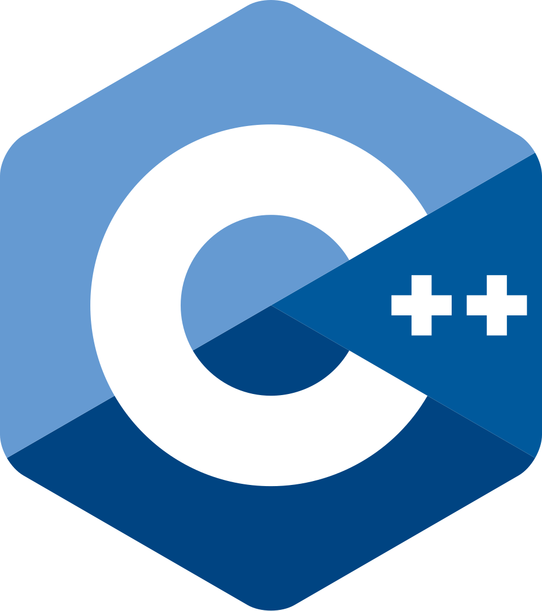
* 
* 💥

<!--
Let's go back in time almost 15 years ago ...

I started my professionnal life as a software engineer integrating signal processing algorithms and machine learning models in embedded devices, working mainly in C++ and assembly.

One of the major aspects of the job was to take MATLAB notebooks from a Data Science team, port it to C++, and when needed optimize some it in assembly. When something was not behaving right in the algorithm itself, iterating in this context was not easy to meet production requirements.

Needless to say, it was not love at first sight, the early days of collaboration between data science and engineering were a bit rough as you can imagine...
 -->

---

## 🐍️ The snake comes along

* 
* 
* 
* ❤️

<!--
A few years later, Data science teams of the industry started to embrace the Python data ecosystem.

Engineering teams also started to adopt the Python ecosystem, especially when developing products without hard realtime constraints.

The love story started to take off!

Unified tooling meant breaking down silos between data science and engineering teams,
yielding to faster iterations between research and engineering,
benefitting from a single programming language with native library bindings for performance tuning,
reducing time to production from months to days,
offering new opportunities for automations,
all of that in a free software ecosystem ensuring extensive community support and longevity.

The future was bright! Right? Right?...
-->

---

## 💔 Every love story comes to an end

* 
* 💔
* Please stop sending me `untitled.ipynb`
* Works in my notebook, you can deploy it
* What is this 4 GB pickle file?
* Just need a GPU and 64 GB of RAM
* Why do you need `matplotlib` for inference?
* We don't write tests, this is R&D
* The model takes 30 seconds per request
* `model_final_v2_FINAL_really.pkl` is on Sharepoint
* Is this reproducible?
* The data changed, nobody told us
* I like CSVs and Excel 📊
* Do you have a `Dockerfile`? 🐳

<!--
Fast-forward 15 years

Did the relationship between Data Science and Engineering teams hold up the test of time?

Not quite: we were on a break!

The ideal streamlined factory of having research output automatically handed-off to engineering pipelines to production rarely reached the end. Iterations are a bit faster but not that much.

Why are we still working in silos even though we are using the same tooling?

Turns out the issues do not lie completely in tools, but most probably in human organization.
 -->

---

## 🚧 Walls of confusion

* 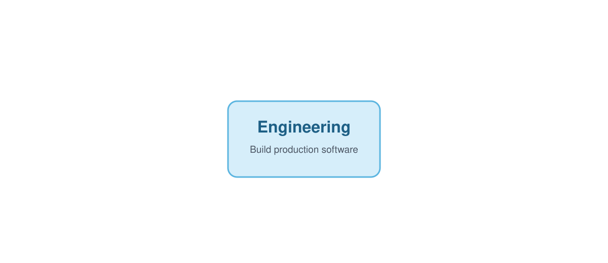
* 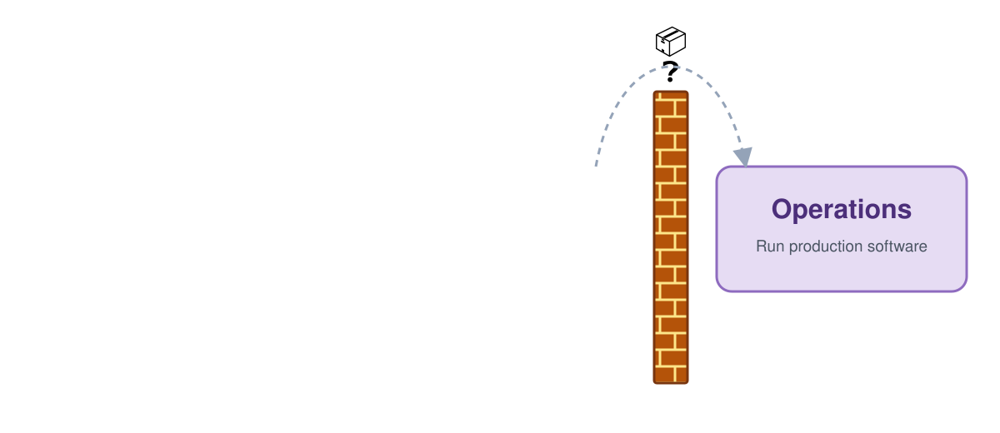
* 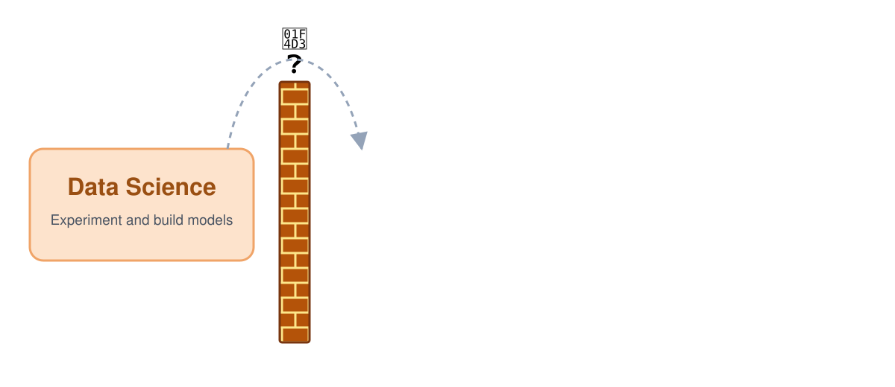

<!--
The issue at heart is what has been known as the "wall of confusion", an expression popularised by Andrew Clay Shafer at the beginning of the DevOps movement around 2008, and by Gene Kim in his series of pseudo-fictional books "The Phoenix Project" and "The Unicorn Project".

The metaphor aims at pointing the lack of communication between teams, the difference of incencitive regarding deliveries and the global lack of team collaboration in a complex technical project.

The first well-known wall of confusion was indeed between software engineering and operations teams: do not just throw the software to be run in production, but package it with your context knowledge, anticipate infrastructure requirements, use automated processes to limit human-error and allow regular and fast iterative deployments (CI/CD), etc.

As you may have guessed already, today we will focus on the second wall of confusion: the one between data science and engineering teams.
 -->

---

## 🌍 Prioritize real-world usage and data

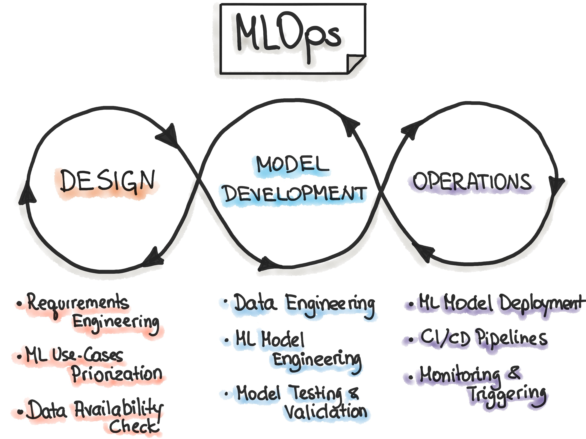

<small>Source: <a href="https://ml-ops.org">ml-ops.org</a></small>

<!--
From these walls of confusions, the main MLOps (short for Machine Learning Operations) principles have emerged.

The idea is to provide a interative framework enabling data scientists to test and validate hypothesis quickly, by confronting trained models with real-world data as soon as possible. You can have the best model on a validation bench, it is absolutely useless if not integrated into the whole system.

This is no rocket science, just common sense and close collaboration from the start with engineering and operations teams.

If you are not familiar with this kind of way of collaboration, just remember one thing: get out of the experimentation zone quickly!

Usual arguments against this kind of practice from data science:
- "I don't have enough data to work with"
- "My model is not ready yet"
- "We don't need to re-train models regularly"
- etc.
And while I respect these, to that I answer: for initial integration work, you don't need SOTA. You need an interface contract so engineering and operations know in advance how to integrate the work. You can build either a dummy model respecting the interface contract, or reach for a baseline rule-based model, and then switch to statistical learning.

Usual arguments against this kind of practice from engineering:
- "Our micro-services architecture is not ready yet"
- "Our multi-stage data pipelines are not ready yet"
- "We don't have an ML model registry"
- "We need to rewrite the code from notebooks to production software"
- etc.
And again, while I respect these, to that I answer: focus on the end-to-end process first, make it run properly in a simple architecture first and provide the data to gather feedback (both on the system running it and the data and model itself). Then you can complexify progressively the architecture if scaling is required, or heavy GPU-based distributed compute is relevant, etc.

This will also have the added effects of progressively:
- start making reproducible results and track artifacts properly
- justifying larger models performance gains
- make continuous trade-offs between model performance and resource usage constraints
- start automating parts of the whole chain

I won't go into details for all these aspects today obviously it would take us at least half a day. But I'll focus on topics that can be controversial but that I consider as must-have when initiating an MLOps strategy.
 -->

---

## ⚠️ Word of caution

> The following **topics** and **material**:
> - are heavily **opinionated**,
> - can be **controversial**,
> - and might **not fit every situation**.

<!--
Small disclaimer:

The following material can be controversial, might not be adapted to every situation and can be very opinionated.

Also, please don't be offended and let's all have a good laugh at our own disfunctions!
 -->

---

## 📓 Deploy your notebooks

* 
* 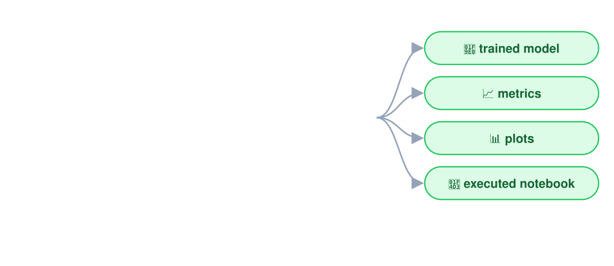
* 
* 
* 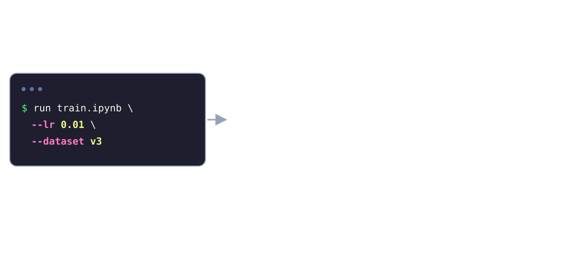

<!--
Okay let's dive in. Engineers are going to hate me for this but bear with me.

Yes notebooks. One of the most dreaded artifacts of engineering in the MLOps circles. And for good reasons sometimes. But they serve a real purpose, that is to provide fast narrative and visual feedback for data science teams during the design phase.

If we want to encourage and enable fast iterations, why would those notebooks have to be re-developed from scratch in a different software component? Can't we start integrating them almost as-is in the beginning until the modelling is stabilized?

Yes. And yes, this is under-engineering at its finest.

But is it different that an executable program when done properly?
A notebook will do some data analysis and processing and output artifacts: trained models, metrics, data files, plots, and the executed notebook itself with output cells.

The only real requirement to be in-place is determinism and reproducibility.
Regarding determinism, the cells of a notebook must be able to be run in order and have the notebook do the expected result (no specific cell ordering shenanigans).
Regarding reproducibility, a notebook like any software program needs a locked environment, that is to say using a proper package manager with what we call a "lockfile": you specify which exact runtime version you need and the minimum set of dependencies requires, and you lock all transitive dependencies. If you are in Python land, the current golden standard is "uv" but you can use any other one as long as you can lock your environment precisely.

And then it is just a matter of parametrizing the notebook allowing you to treat it like a self-contained program / CLI taking inputs and performing anything a program can do, with I/Os etc.
 -->

---

## 📓 Deploy your notebooks

* 

Parameterize and run Jupyter notebooks

$ papermill train.ipynb out.ipynb &nbsp;&nbsp;-p lr 0.01 -p dataset v3

* 

Notebooks stored as plain Python scripts

$ python train.py &nbsp;&nbsp;-- --lr 0.01 --dataset v3

<!--
If you are in the Python ecosystem, you currently have at least 2 choices for executing notebooks:

- Papermill for Jupyter notebooks: you simply define a top level cell tagged as "parameters" with standard Python variables, and Papermill wrap the execution of the notebook by allowing to pass those parameters dynamically

- And then there is Marimo: the notebooks are real Python programs so you can run then natively like any other Python program. But they do have something more regarding determinism: the cells are Python functions with an implicit dependency graph, meaning the cells always run in order! Might not fit all situations but this is useful in some context.
 -->

---

## 🤒 Resist the OOP fever

* 
When Data Scientistsdiscover OOP

* 

&#9632;<b>PROJ-1337</b>TO DO

Make everything a class

<b>Description</b> Use object oriented programming best practices everywhere according to the software engineering 101 training.

Priority: <b class="hi">&#9650; Highest</b>Assignee: <i>Unassigned</i>Labels: best-practices

* <pre class="card code" style="left: 250px; top: 150px; --tilt: -2deg;">
  class Preprocessing:
      """Namespace for preprocessing."""
      @staticmethod
      def clean(df): ...
      @staticmethod
      def normalize(df): ...
      @staticmethod
      def split(df): ...
  </pre>
* <pre class="card code" style="left: 270px; top: 170px; --tilt: 3deg;">
  class LoadData:
      def __call__(self, path): ...
  class CleanData:
      def __call__(self, df): ...
  class TrainModel:
      def __call__(self, df): ...
  model = TrainModel()(CleanData()(LoadData()("data.csv")))
  </pre>
* 
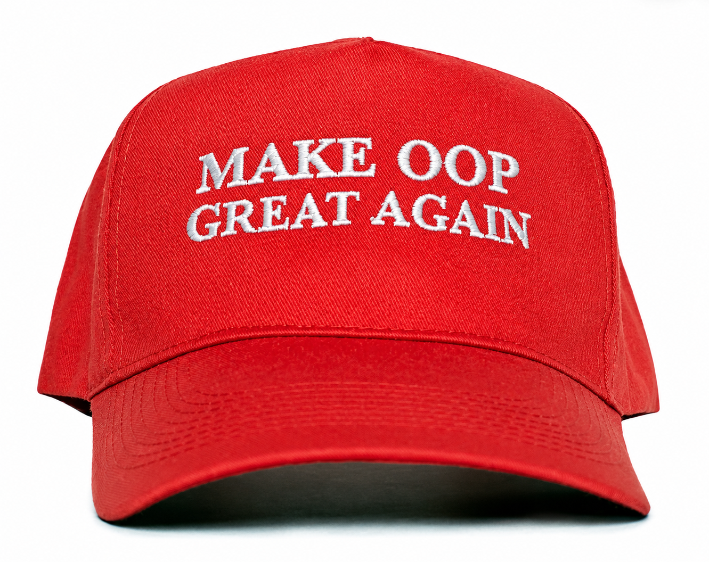

* 

<!--

Okay so now this is the data science crowd who's gonna come at me...

Listen: I don't love OOP (short for objected oriented-programming) but I don't hate it either. However, I get a tiny bit angry when I see some exotic constructs for no reason.

Sometimes I feel like I'm watching a Stanley Kubrick movie: why is OOP so highly regarded as a software engineering practice?

Seriously, who told you that to make your code professionnal, you have to use classes?? (by the way this is a fake recreation of a real Jira ticket I've seen with my own eyes)

Using classes as a namespace for static functions? Really?
Using classes as...functions? Really? (I mean don't get me wrong, this has the potential for some advanced software engineering pattern for event driven handling etc. but not here no)

Is there a secret conspiracy to bring OOP back in style? MOGA anyone?

I'll stop the jokes here but the only thing I want to say is: use functions!
-->

---

## 🤒 Resist the OOP fever

* 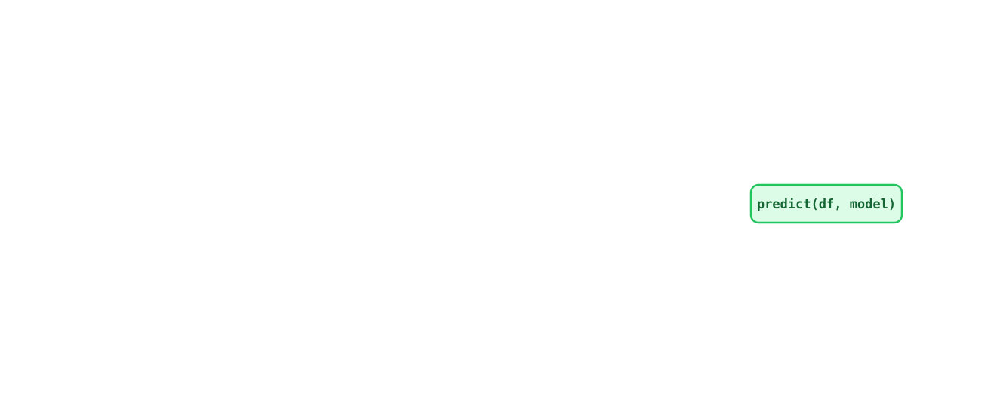
* 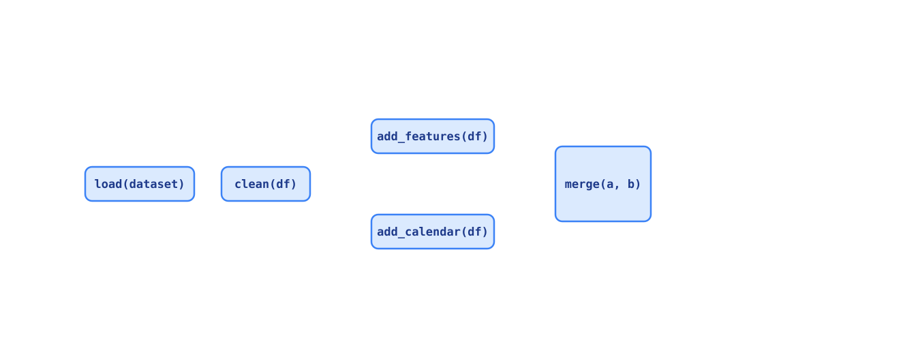
* 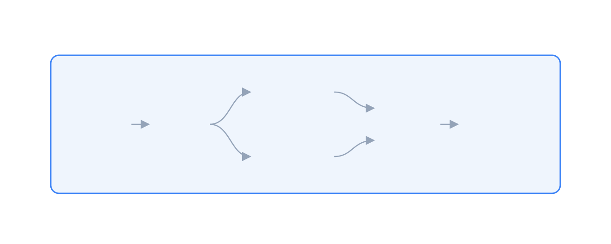
* 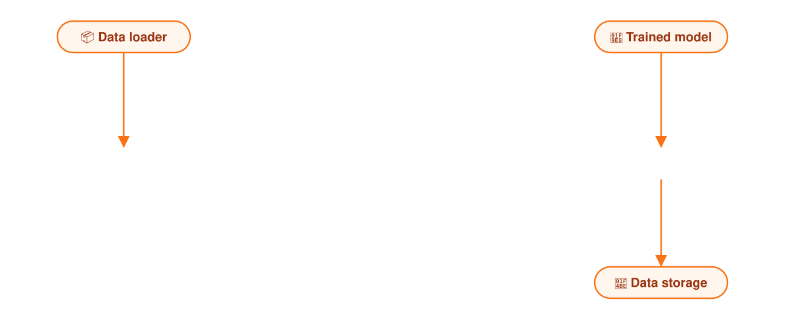
* 
* 

<!--
Okay so why use functions instead of classes and objects?

Functions carry no state, they are "stateless", takes input parameters and return output results.
Hence they provide deterministic behavior (mostly, if no side-effects are introduced), and are easy to test, debug and reuse.

One cool thing is that functions can be composed to make a graph. And it happens that lots of data processing workflows can be expressed as DAGs (short for Directed Acyclic Graphs).

Okay great but I still need to keep a state somewhere at some point for the graph to operate, whether for input, output and intermediate data. How should we do that if we only use stateless functions?

You can simply push the statefulness responsibility of the data processing graph to the execution environment. You keep the state at the boundary of the system so it can easily be swapped and this plumbing stays very localized.

The execuiton environment can start with a notebook chaining some functions with keeping the state in the notebook global state. Then you can graduate almost for free to using a full-blown DAG orchestrator like Airflow or Dagster, where managing the state will be a matter of configuring the orchestrator: the unit functions will still take input values and return output results!

Structuring any data processing workfow this way allows to speed up quite a lot the path to integration and production!

As a reference, this pattern of is commonly called "Functional core, imperative shell".

(
other advantages:
- no more hidden mutations
- reproducibility
- caching
- parallelisation
- backfills and reprocessing
)
-->

---

## 📦 Deliver models using standard formats

* 
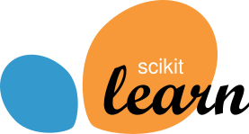

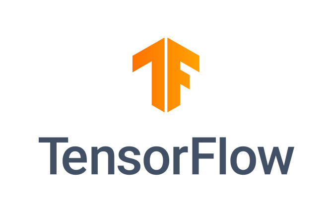

* 

Targets

☁️ Cloud · 📱 Mobile 🌐 Browser · 📟 Edge

Hardware

CPU · GPU NPU · TPU

Languages

Python · C++ · C# Java · JavaScript Rust · Go

* 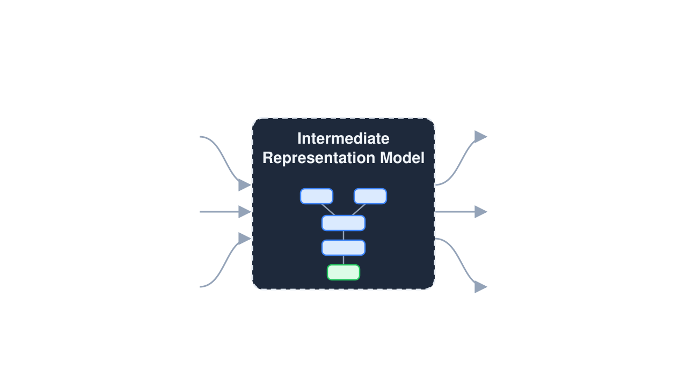
* 

<!--
Last topic for today: delivering models.

Most data science teams work in a flexible environment: a dynamic language like Python or R, a heavy ML framework like scikit-learn, pytorch or tensorflow, etc.

Most engineering teams build software with different constraints: maybe they are developing using dynamic languages but they limit the dependencies footprint so ML frameworks are out of the way, or maybe they are using a compiled language like C++, Rust or Go.

So simply handing the model inference pipeline implementations using dynamic languages and heavy dependencies can cause integration issues.

They are usually two ways of solving this problem:
- Deliver a model in the form of a REST API or a process that can be invoked: but maybe you can't or don't want to go down this route
- Another way is to deliver the model using an abstract representation.

One of the most popular format for intermediate model representation is ONNX (short for Open Neural Network Exchange format). Even though the name says "neural network" you can use it for any computations, but the format happens to have lots of pre-defined units for neural network specific layers (like Convolutional Layers, etc.). To use an abstract model like ONNX, you then simply need to have a model runtime (here, ONNX Runtime built in C++ with binding in many languages).

Most ML frameworks inference pipelines can be either exported directly or expressed as ONNX.

And on the other side, most programming languages can load ONNX models through the ONNX Runtime (if some of you have seen my talk last year at PyData Paris 2025, you can run them in your browser using WebAssembly and WebGPU!)

Oh and that's not the only benefit. You also get:
- automatic optimizations (nodes are vectorized and optimized by the provided runtime)
- automatic hardware acceleration (cpu, gpu (nvidia cuda, openvino), npu, etc.)
- can fit the pre and post processing inside!
- can subdivide in subgraphs! (and distribute/parallelize!)
 -->

---

## 📦 Deliver models using standard formats

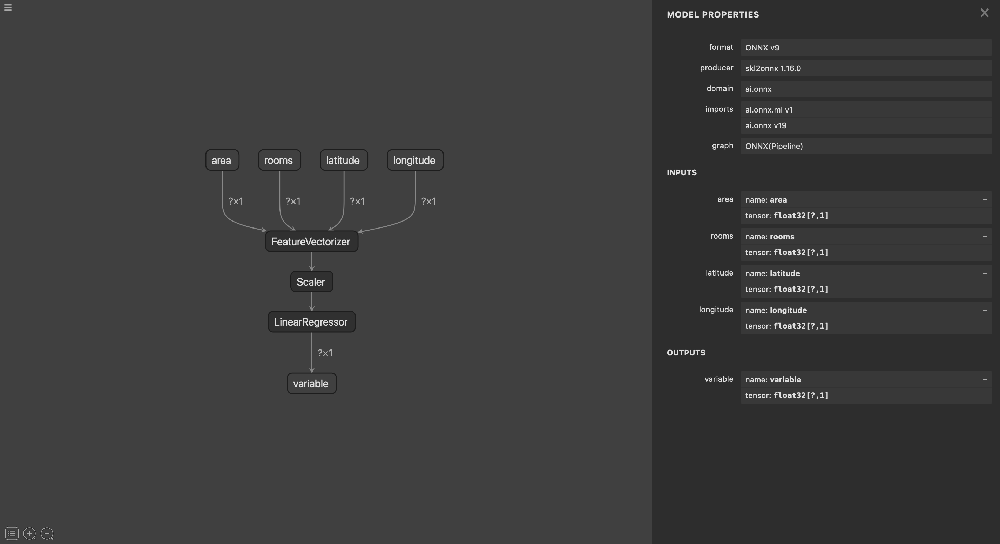

<!--
If you are not familiar with such model formats, let me give you a quick sneak peek.

As you can see, this is just a graph of unit operations chained together. Recall what I said about DAGs earlier?

This example is pretty trivial but that just for readability. Of course real-world model graphs are usually much more dense than this one.
 -->

---

## 🗂️ Use a model registry

* 
📁 Sharepoint › Data Science › Models

📄 model_final.pklMonday

* 
📄 model_final_v2.pklTuesday

* 
📄 model_final_v2_FINAL_really.pklFriday, 18:47

* 
📄 model_FINAL_USE_THIS_ONE.pklSaturday, 03:12

* 
📄 model_FINAL_USE_THIS_ONE (1).pklJust now

<!--
And how do you know which model is the right one? You've all seen this folder.
 -->

---

## 🗂️ Use a model registry

* 
* 
* 
* 
* 
* 
* 
* 
* 
* 

📚 Model Registry

house-price

Data Science

<b>v1</b>MAE 31k

<b>v2</b>MAE 23k

<b>v3</b>MAE 21k

🔥 breaks in prod

@champion

Operations

runs in production

house-price@champion

= v1= v2= v3

Engineering

integrates the new version

<!--
Use a model registry: corner stone for an MLOps strategy

It is the shared contract between data science and engineering: which model is it, where does it come from, and which one should be used.
Nothing is captured by magic: the training run has to log the data version, the code commit and the environment.
Consumers don't ask for a file path, they ask for an alias (for instance with MLflow).
Rollback is just moving the alias, nothing changes in the consuming code.

A registry doesn't make your model better. It means nobody has to ask which one is in production.
 -->

---

## ❤️‍🩹 Getting back together

- Integrate end-to-end early
- Deploying notebooks at first is okay
- Prefer functions and graphs
- Use standard model formats
- Use a model registry

---

## 🔭 Other possible topics

After initial steps, more advanced topics can be tackled:

- Centralized data management
- Data and model drift monitoring
- Security
- AI coding agents
- etc.

---

## Romain Clement

Independent MLOps consultant
**Datalpia**

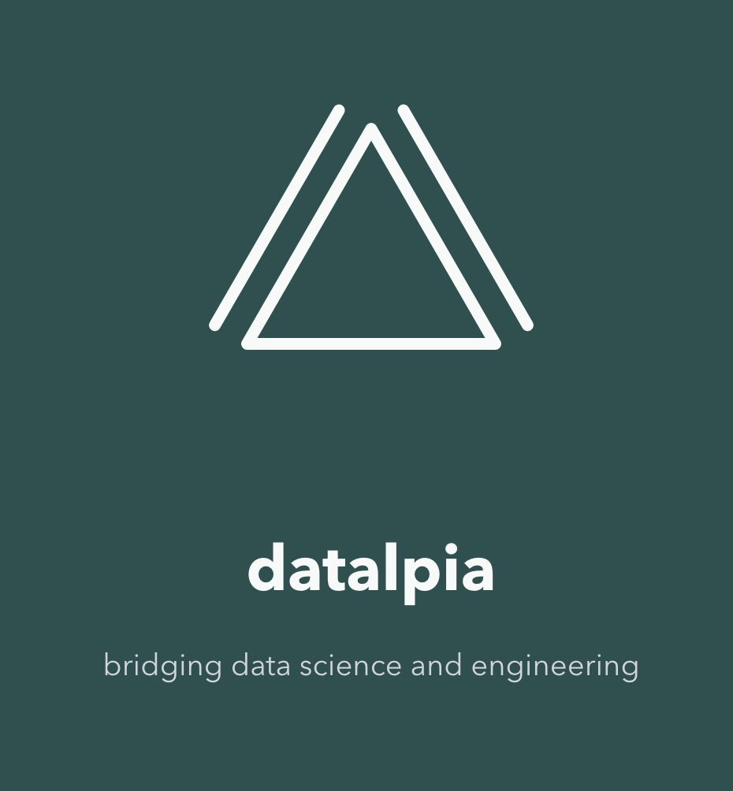

🌐 [datalpia.com](https://datalpia.com)
🌐 [romain-clement.net](https://romain-clement.net)
🔗 [linkedin.com/in/romainclement](https://www.linkedin.com/in/romainclement)

---

# 🙋 Questions ?

Thank you! Let's chat!

---

## 📚 References

- [ml-ops.org](https://ml-ops.org/)
- [ONNX](https://onnx.ai/)
- [Papermill](https://papermill.readthedocs.io/)
- [Marimo](https://marimo.io/)
- [MLflow](https://mlflow.org/)
- [Netron](https://netron.app/)
- Logos of C++, MATLAB, Python, Scikit-Learn, PyTorch, Tensorflow, ONNX from [Wikimedia](https://www.wikimedia.org/)
- All "Friends" pictures from [IMDb](https://www.imdb.com/)

Note: some illustrations were generated using Generative AI

<!--
## Data Science and Engineering: We Were on a Break!

### Abstract

MLOps was supposed to be the extension of DevOps applied to ML-centric software. But the story is not so simple, and in 2026 the collaboration between data scientists and engineers is still not so smooth in most organizations. Let's try to find some pragmatic actions to improve the situation!

### Description

Fifteen years ago, teams were struggling to deliver MATLAB models to engineering teams because of real technical challenges (porting to C/C++, floating-point vs fixed-point computations, assembly optimizations, etc). In 2026, the machine learning ecosystem has mostly converged to Python for the entire lifecycle with a promise to break down silos and streamline the deliveries from research to engineering to production. But in reality, data science and engineering teams still struggle to deliver smoothly.

What if the core issue was not technical but human? How to make data science care about engineering, and vice-versa?

In this talk, we'll cover some common situations from the field of MLOps, among which:

- Start simple and iterate
- Resist the OOP fever
- Deploy your notebooks
- Deliver models using standard formats
- Prioritize real-world usage and data

You will leave with some pragmatic actions, illustrated with open-source technologies mostly in the Python ecosystem (such as Papermill, Marimo, ONNX, MLflow).

This light-hearted talk is intended for data scientists, ML/Data/Software engineers and technical leads looking for a pragmatic angle to reduce the time to delivery of ML-driven products.

Some familiarity with data science activities and/or software engineering is advised.

 -->